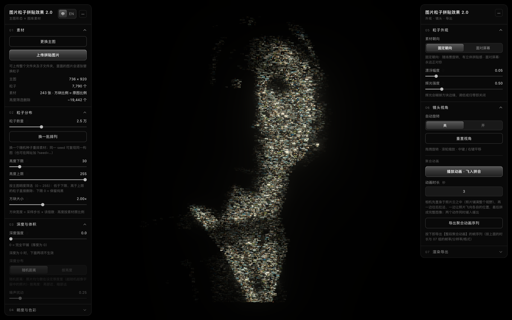

# 图片粒子拼贴效果 2.0 / Particle Collage 2.0

把一张主图变成由成千上万张小照片组成的粒子拼贴：每颗粒子换成一张素材图，主图的明暗决定每张方块的亮度；镜头可以从照片云里飞入、拼成完整图像；支持 4K、竖屏、透明 PNG 的逐帧导出。



**在线演示**：<https://afeiisfine.github.io/particle-collage/>  
**离线单文件版**：[Releases · v2.0.0](https://github.com/AfeiIsFine/particle-collage/releases/tag/v2.0.0)  
（下载 `particle-collage-2.0-share.zip`，解压后双击 `index.html`，不需要本地服务）

## 这是什么

- **主图决定形态**：拖入一张图，按像素明度采样出粒子；暗部、透明像素不生成方块，所以人像/剪影会自然成形成镂空。
- **素材决定质感**：上传一个文件夹（递归子目录），每张图替换一个粒子；素材不够会自动循环复用。
- **拼贴而不是马赛克**：方块高度跟随素材原比例，可重叠；素材通过纹理数组逐张独立显示，靠近能看清每张照片。
- **镜头动画**：从“置身照片云”的近距离起手，镜头边后退、方块边飞向各自位置，最后拼成完整图像。
- **导出**：06 导出整段飞入拼合；07 导出当前画面序列或单帧；帧写入选定文件夹下的独立子文件夹，方便剪辑软件按序列导入。

## 2.0 的关键改动

- **素材纹理数组 + 每层 mipmap**：不再把素材拼进一张图集，远离时不会闪烁/摩尔纹，近处每张独立；默认 243 张素材仍是 16MB 级别。
- **Composer 4× MSAA**：方块几何边缘更干净。
- **导出是真正的快照**：导出期间面板锁定、自动旋转关闭、载入飞入进度冻结；中途点播放或改窗口不会污染成片。
- **竖屏/方图**：4:5 / 9:16 / 1:1，并按目标比例重新取景。
- **透明 PNG**：背景 alpha=0（自动关 bloom）；JPEG 仍是黑底。
- **可复现**：默认 `seed=20261017`，同一 seed + 同一组参数 = 同一构图；「换一批排列」换 seed。
- **方块始终正放**：不做随机面内旋转。
- **深度为 0 时**：噪声/深度分布自动置灰，不再“拖了没反应”。
- **每次序列独立子文件夹**：`frames_YYYYMMDD_HHMMSS/`，帧从 `frame_00001` 开始，旧帧不会混进来。

## 快速开始

### 在线

打开 <https://afeiisfine.github.io/particle-collage/>。  
需要 Chrome / Edge 或 Safari 16.4+，并且浏览器支持 WebGL2。

### 本地

```bash
cd particle-collage
python3 -m http.server 8125 --bind 127.0.0.1
# 浏览器打开 http://localhost:8125/index.html
```

在线版和本地版都不需要联网；图片完全在浏览器里处理，不会上传服务器。

> 导出文件夹使用 File System Access API，需要 Chrome / Edge（Safari 暂不支持选择文件夹）。

## 怎么用

1. **换主图**：把图片拖进窗口，或点 01 组「更换主图」。
2. **上传拼贴图片**：点 01 组「上传拼贴图片」，选一个图片文件夹；会递归读取子文件夹。也可以把多张图拖进窗口（首屏之后仍可用）。
3. **调分布**：02 组控制粒子数量、亮度上下限、方块大小；「换一批排列」重排素材。
4. **调深度**：03 组控制厚度、随机/按亮度分布、噪声；深度为 0 时后两项无效。
5. **调明度**：04 组选择正片叠底或亮度替换，调 γ / 增益。
6. **调外观**：05 组控制固定朝向 / 面对屏幕、漂浮幅度、辉光。
7. **播放动画**：06 组「播放动画 · 飞入拼合」；「重置视角」同时把图像拼回完整状态。
8. **导出**：07 组选择序列/单帧、帧率、分辨率、背景与格式，再点导出。

## 导出

- **07「导出帧序列」**：把当前画面原样录一段；相机和聚合度不动，只有粒子的细微漂浮在走。
- **07「单帧」**：只渲染当前这一帧。
- **06「导出聚合动画序列」**：无视 07 的内容选择，强制导出整段飞入拼合。
- **分辨率**：1920×1080 / 2560×1440 / 3840×2160 / 1080×1350（4:5）/ 1080×1920（9:16）/ 1080×1080（1:1）/ 当前窗口。
- **格式**：JPEG（0.95）/ PNG；PNG 可选透明背景。
- **文件**：序列会在所选文件夹里新建 `frames_YYYYMMDD_HHMMSS/`，命名 `frame_00001.jpg/png`；单帧名带毫秒。
- **停止**：屏幕上方进度条可随时停止，已写出的帧会保留。

## 浏览器 / 性能

- Chrome / Edge 最新版最佳；Safari 16.4+ 可跑主场景，但不支持选择文件夹导出。
- WebGL2 必需（纹理数组 + mipmap）。
- 默认 7,790 个粒子；60k 粒子在 1280×800 / DPR1 下可保持约 60fps（M 系列 Chrome 实测）。
- 素材上限：`min(1024, 显卡 MAX_ARRAY_TEXTURE_LAYERS)`；超过会提示并截断，不再静默丢图。

## 开发

```bash
# 本地静态服务
python3 -m http.server 8125 --bind 127.0.0.1

# 生成单文件分享版（需要 Node/npx + esbuild）
python3 build_share.py
# → dist/index.html + particle-collage-2.0-share.zip
```

源文件：

- `index.html` —— 页面、样式、three.js 场景、着色器、导出逻辑全部在这里；
- `libs/` —— three.js r160 与 addons；
- `materials-manifest.js` —— 默认 243 张素材缩略图（构建时生成的 data URL）；
- `main.jpg` —— 默认主图；
- `test.jpg` / `test-assets/` —— 开发自测用图；
- `build_share.py` —— 把 three.js、素材清单、主图内联成单文件分享版。

默认素材清单和主图是作者提供的演示素材；商用/二次分发前请替换为你自己的图片。

## 素材与许可证

- **代码**（`index.html`、`build_share.py`、`libs` 以外的脚本逻辑）：MIT，见 [LICENSE](LICENSE)。
- **默认演示图片**（`main.jpg` 与 `materials-manifest.js` 内嵌的 243 张缩略图）：© 2026 AfeiIsFine（阿飞这个名字挺好的），仅随本仓库作为演示提供，**不包含在 MIT 许可证内**；如需复用这些图片，请先联系作者。使用代码时请把默认图片替换成你自己的素材。
- **three.js r160**：MIT，版权归 three.js 作者；见 `libs/three.module.js` 文件头与 <https://threejs.org>。
- `test.jpg` / `test-assets/` 是开发自测图案，可随代码一起用于测试。

## Credits

- Built by [AfeiIsFine（阿飞这个名字挺好的）](https://github.com/AfeiIsFine)
- three.js r160
- 设计/交互：工具类 UI 风格（单色阶、细线分层、右对齐读数）

## 相关项目

- 前作：[图片转粒子点云效果 / particle-pointcloud](https://github.com/AfeiIsFine/particle-pointcloud) —— 同样是把主图采样成粒子，但用点云而不是照片方块。
